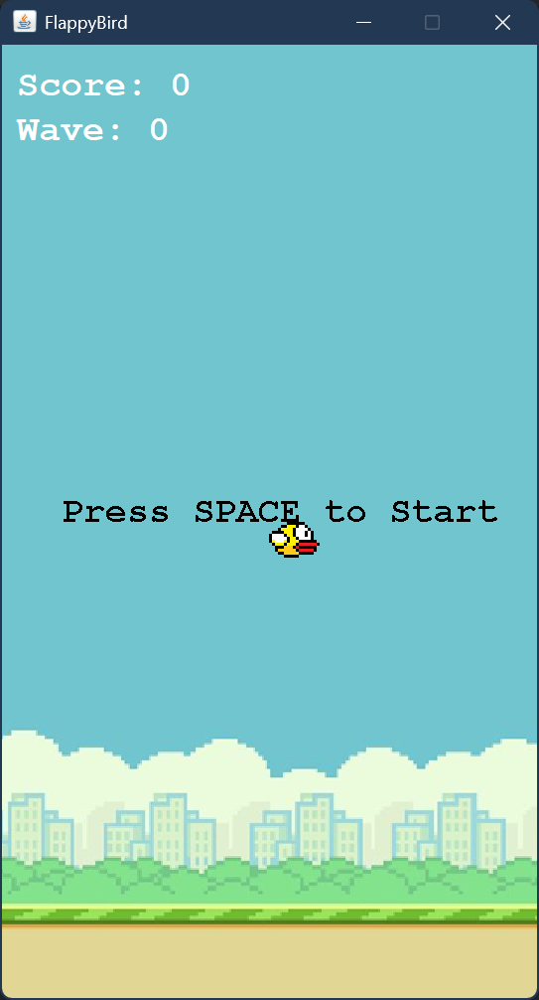
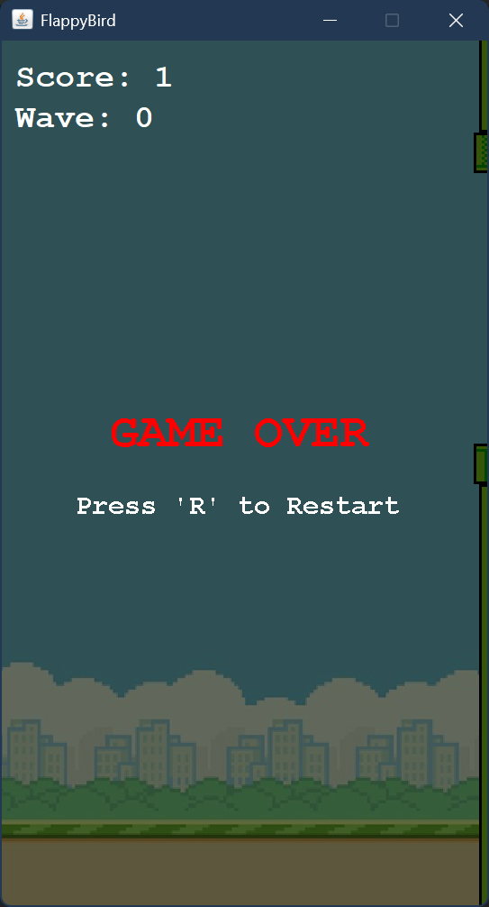
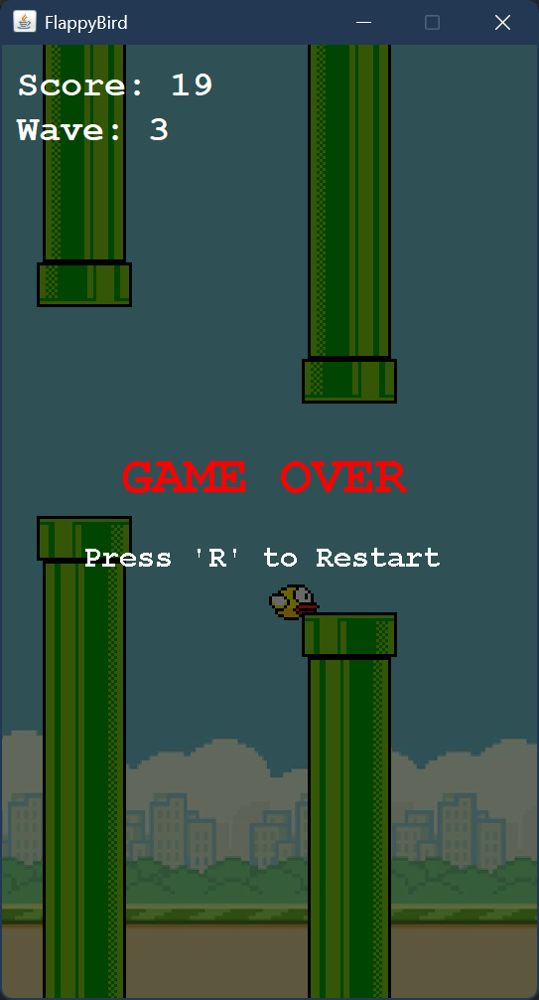
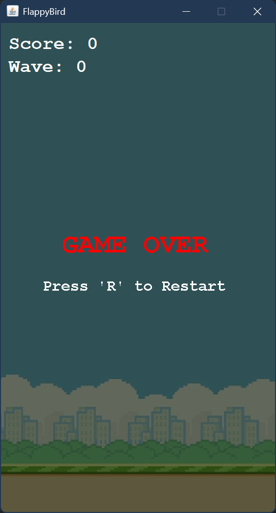
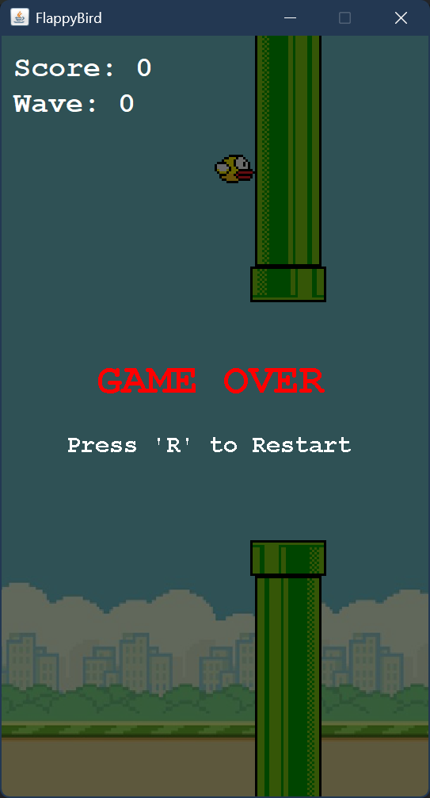
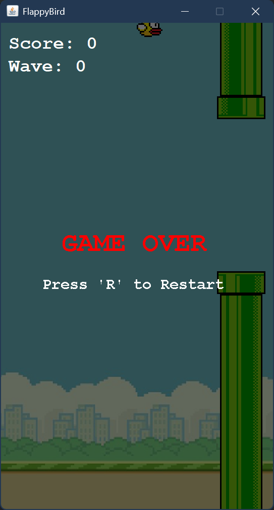

# TP6DPBO2425C1
java swing flappybird but have wave instead of increment overtime

# FlappyBird Manuk
## 1. Desain Program (Arsitektur Kelas)

Program ini menggunakan pola arsitektur **MVC sederhana (Model-View-Controller)** yang dimodifikasi:

*   **`App.java` (Entry Point):** Menginisialisasi `JFrame` utama, membuat objek `Logic`, `View`, dan menghubungkan keduanya. Mengatur ukuran jendela (360x640) dan fokus keyboard.
*   **`Logic.java` (Controller & Game Loop):** Mengimplementasikan `ActionListener` dan `KeyListener`. Kelas ini mengatur *state* permainan (skor, `gameOver`, `isStarted`), gravitasi (`gravity`), kecepatan pipa (`pipeVelocityX`), posisi pemain, deteksi tabrakan, serta sistem tingkat kesulitan (`updateDifficulty()`). `Timer` di sini berfungsi sebagai *game loop* (60 FPS) dan *spawner* pipa (`pipesCooldown`).
*   **`View.java` (View):** Mengimplementasikan `JPanel`. Bertanggung jawab untuk merender visual (background, `Player`, `Pipe`, teks instruksi, dan layar Game Over) melalui method `draw(Graphics g)`. Juga menampilkan `scoreLabel` dan `waveLabel`.
*   **`Player.java` (Model):** Menyimpan state burung (posisi `posX`, `posY`, `width`, `height`, `image`, `velocityY`). Memiliki method `getBounds()` untuk mendeteksi tabrakan.
*   **`Pipe.java` (Model):** Menyimpan state pipa (posisi, ukuran, `image`, `velocityX`, `passed`). Juga memiliki method `getBounds()` untuk hitbox.
*   **`Sound.java` (Utility):** Mengelola pemutaran audio menggunakan `javax.sound.sampled.Clip`. Memuat file BGM (`bgm.wav`), suara lompat (`jump.wav`), dan suara skor (`poin.wav`).
*   **`FontLoader.java` (Utility - jika ada):** Memuat font kustom (jika menggunakan font eksternal).

## 2. Penjelasan Alur Permainan

1.  **Inisialisasi:** Saat program dijalankan, `App` membuat frame, lalu `Logic` diinstansiasi. Di dalam constructor `Logic`, semua aset (gambar, suara) dimuat, lalu `setupGame()` dipanggil untuk mengatur posisi awal burung, mengosongkan pipa, dan mereset skor.
2.  **Game Loop:** `gameLoop` (Timer 60 FPS) berjalan terus-menerus memanggil `actionPerformed` yang di dalamnya memanggil `move()` dan `view.repaint()`.
3.  **Menunggu Aksi:** Game belum dimulai (`isStarted = false`). Pipa tidak bergerak dan burung diam. Layar menampilkan teks "Press SPACE to Start".
4.  **Mulai Bermain:**
    *   Pemain menekan **SPASI**. `Logic` mengubah `isStarted = true`, memutar BGM (`sound.playBGM()`), dan memberikan kecepatan negatif pada burung (`player.setVelocity(-10)`).
    *   `move()` mulai bekerja: menerapkan gravitasi (`velocityY += gravity`), menggerakkan pipa, dan mendeteksi tabrakan.
    *   `pipesCooldown` (Timer) mulai memanggil `placePipes()` secara berkala untuk memunculkan pasangan pipa baru.
5.  **Skor & Kesulitan:**
    *   Jika `player` melewati pipa (posisi X pipa < posisi X player) dan pipa belum ditandai `passed`, maka `score` bertambah, suara poin dimainkan, dan `updateDifficulty()` dipanggil.
    *   `updateDifficulty()` akan mempersempit `openingSpace` (celah pipa) setiap kelipatan 5 skor, dan mempercepat `pipesCooldown` (jarak antar pipa).
6.  **Game Over:**
    *   Jika burung menabrak pipa (`intersects`), menyentuh batas atas (`posY < 0`), atau jatuh ke bawah (`posY > frameHeight`), maka `gameOver = true` dan BGM dihentikan.
    *   Pergerakan berhenti (karena ada `return` di `move()`), dan `View` menampilkan layar transparan gelap dengan teks "GAME OVER" dan "Press 'R' to Restart".
7.  **Restart:** Jika pemain menekan **R** saat `gameOver == true`, `setupGame()` dipanggil kembali untuk mereset semuanya (posisi burung, pipa, skor, dan delay pipa).

## 3. Mekanisme Deteksi Tabrakan (Hitbox)

Deteksi tabrakan menggunakan method `getBounds()` yang mengembalikan objek `Rectangle`.
*   **`Player.getBounds()`:** Mengembalikan rectangle dengan margin 2 pixel di setiap sisi (`posX+2`, `posY+2`, `width-4`, `height-4`). Tujuannya agar tabrakan terasa lebih "adil" karena tidak menghitung pixel pinggiran gambar burung.
*   **`Pipe.getBounds()`:** Mengembalikan rectangle presisi sesuai ukuran gambar pipa.
*   **Pengecekan:** `player.getBounds().intersects(pipe.getBounds())` digunakan di dalam loop `pipes` pada method `move()`.

## 4. Sistem Kesulitan (Difficulty Scaling)

Tingkat kesulitan meningkat secara dinamis berdasarkan jumlah skor:
*   **Celah Pipa (`openingSpace`):** Awalnya 200px. Setiap kelipatan 5 skor, celah dikurangi 20px hingga batas minimum 100px.
*   **Jarak Antar Pipa (`pipesCooldown.setDelay`):** Delay awal 3500ms. Setiap kelipatan 5 skor, delay dikurangi 500ms hingga batas minimum 900ms. Ini membuat pipa muncul lebih rapat seiring bertambahnya skor.

## 5. Catatan Teknis

*   **Game Loop:** Menggunakan `javax.swing.Timer` dengan delay `1000 / 60` (sekitar 16.6ms per frame).
*   **Aset Gambar:** Dimuat menggunakan `ImageIcon` dari folder `assets` (`bird.png`, `background.png`, `upperPipe.png`, `lowerPipe.png`).
*   **Aset Suara:** Dimuat menggunakan `AudioSystem` dari folder `sound`. Mendukung format `.wav`.
*   **Font:** Menggunakan font bawaan `"Monospaced"` dengan gaya `Font.BOLD` untuk memberikan kesan retro/pixel.
*   **Perulangan Pipa:** Menggunakan *backward loop* (`for(int i = pipes.size() - 1; i >= 0; i--)`) agar aman saat menghapus elemen `pipes.remove(i)` jika pipa sudah keluar layar.

---

# Dokumentasi

## 1. Menu
Menu dari FlappyBird
 

## 2. Wave
Ketika wave 0, jarak antar pipa secara vertikal dan horizontal lebih jauh
 

 
Ketika wave 3, jarak antar pipa secara vertikal dan horizontal lebih dekat
 

## 3. Died
Mati ketika jatuh, menabrak, dan terbang terlalu tinggi
 

 

## 4. Video Gameplay
[![Video Gameplay]](documentation/gameplay.mp4)
